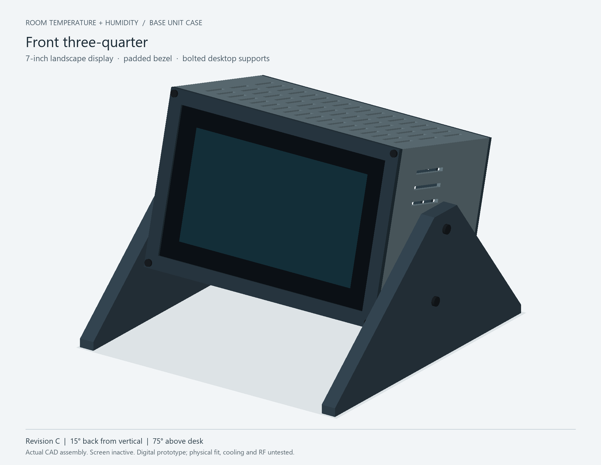

# Base unit case - Revision C

The current digital prototype is [Revision C](revision-C/), with the display
15 degrees back from vertical. It targets the Bambu Lab H2D Pro, bare Raspberry Pi
5 8GB (no cooler) and nRF52840 DK revision 3.0.3, marked 2026.21. DK USB stays
inside the case; only Pi power exits.

Read the [hardware-fit and print checkpoint](revision-C/CONFIRMED-HARDWARE-FIT.txt)
and [assembly instructions](revision-C/ASSEMBLY.txt). Editable CadQuery source,
individual STEP/STL parts, renders and digital verification reports are in
[revision-C](revision-C/). Print the fastener coupon first; duplicate the side
stand once. Do not print the assembled or hardware-proxy STEP as a single object.

Digital checks pass within the documented hardware and cable envelopes. This is
**not a print-ready release**: exact inserts, actual cable boots/bends and H2D Pro
slicer preview remain unresolved. Physical fit, glass padding, fastener loading,
stability, thermal and RF tests have not been performed.

Historical [Prototype A](snapshot-prototype-A/) and
[unfinished Revision B](snapshot-revision-B/PAUSED-CHECKPOINT.txt) are retained for
reference. Revision B has a known failed stand-tab fit and is not current CAD.
Its checkpoint's former personal workspace path is redacted for publication;
source geometry is unchanged.
