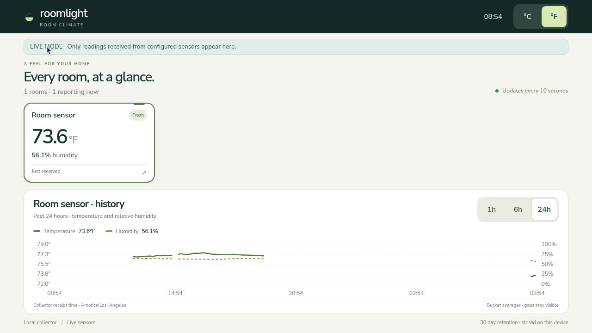
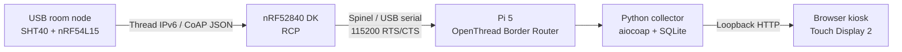
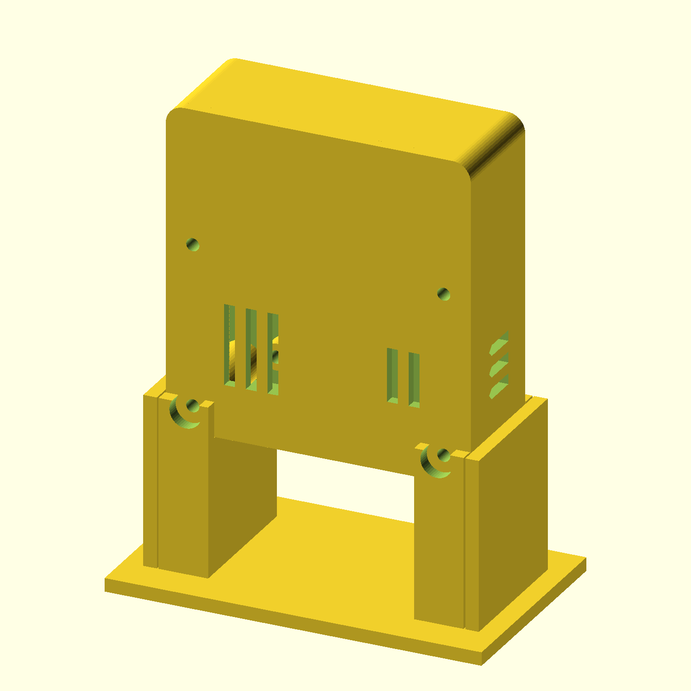
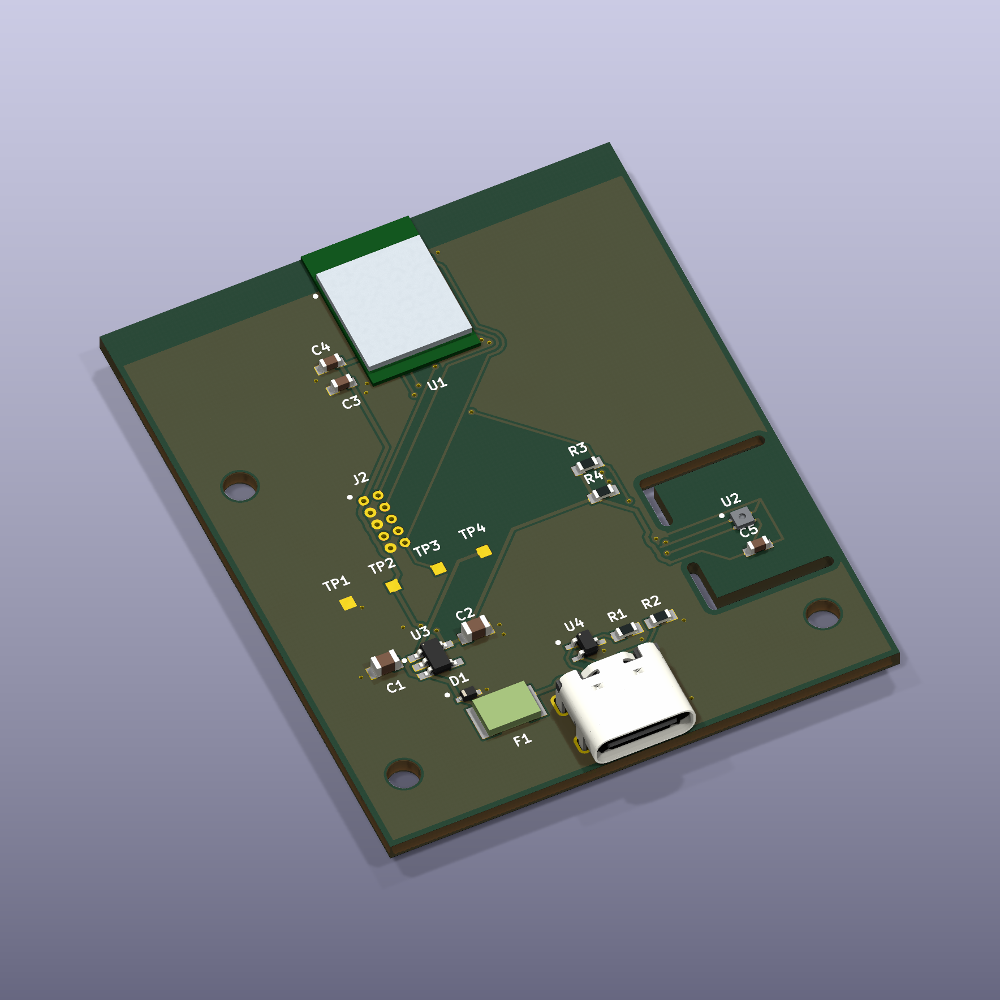

# RoomTempHumidity

A local whole-house temperature and humidity monitor. USB-powered room sensors
send measurements over Thread to a Raspberry Pi base unit, which stores history
and presents a touchscreen dashboard without requiring a cloud service.

## Actual Pi dashboard

Direct capture of the running Pi display on **2026-10-11**. This is the live-mode
application with one reporting prototype sensor, not simulated data. Readings and
freshness reflect the capture time.

## Design summary

- **Sensors:** SHT40 measures temperature and relative humidity. nRF54L15 firmware
  uses Zephyr and OpenThread, samples every minute and sends confirmable CoAP POSTs.
  Random boot IDs and sequence numbers support duplicate/replay handling. Continuous
  USB power permits an always-listening Thread router role.
- **Base radio:** pinned OpenThread RCP firmware on an nRF52840 DK connects over
  Spinel/UART through USB serial. It is separate from the sensor-node application.
- **Networking:** OTBR runs on the Pi 5. Recorded deployment limits forwarding to
  the intended local IPv6 LAN; IPv4 forwarding, NAT64, WebGUI and REST are disabled.
- **Collector/UI:** Python validates readings and stores bounded SQLite history.
  HTML/CSS/JavaScript provides room status, history and Celsius/Fahrenheit controls.
  CoAP bind retries keep the local dashboard available while a Thread address is
  missing. The Touch Display 2 presents the landscape browser/kiosk UI.
- **Protocol:** Thread + IPv6 + CoAP.

## Sensor hardware

| Enclosure A2 | Populated PCB A3 — angled 3D view |
| --- | --- |
|  |  |

The enclosure is a native OpenSCAD render. The populated PCB is a native KiCad
3D render of the unchanged A3 layout and its 16 component placements. Package
models show nominal geometry; the radio module uses a simplified dimension-based
body/shield. Neither image proves assembled hardware qualification.

The working prototype uses an **nRF54L15 DK and SHT40 breakout**. The custom
45 × 55 mm PCB uses Raytac AN54LQ-P15 and SHT40; A3 changes the regulator to
LT1761IS5-3.3#TRMPBF. Custom-board bring-up, printed fit, RF performance and thermal
bias remain unqualified. A3 is **quote/DFM only**, not production/purchase approval.

## Repository layout

| Directory | Contents |
| --- | --- |
| [SensorFirmware](SensorFirmware/README.md) | nRF54L15 DK firmware, pinned SDK manifest, schema and tests |
| [SensorCase](SensorCase/README.md) | A2 OpenSCAD, provisional print parts and fit coupons |
| [SensorPCB](SensorPCB/README.md) | Current A3 native KiCad and selected quote/DFM files |
| [BaseUnitFirmware](BaseUnitFirmware/README.md) | Pinned nRF52840 RCP source/build/UART reference |
| [BaseUnitApplication](BaseUnitApplication/README.md) | Pi collector/dashboard and sanitized OTBR reference |
| [BaseUnitCase](BaseUnitCase/README.md) | Existing prototype-A snapshot; **design paused** |

Canonical workspace: `C:\GIT\RoomTempHumidity`. Future tasks should read
[AGENTS.md](AGENTS.md) and [migration notes](docs/MIGRATION.md).

## Technologies and methodology

Sensor firmware uses C, Nordic nRF Connect SDK **v3.2.1**, Zephyr and OpenThread.
RCP and OTBR use separate immutable upstream commits. OTBR's documented historical
build uses Debug after optimized builds failed a compiler diagnostic; warning and
runtime compatibility checks were retained.

The Pi application uses Python 3.11+, aiocoap, SQLite and HTML/CSS/JavaScript.
Mechanical design uses parametric OpenSCAD, static dimension checks and independent
STL topology checks. PCB work uses native KiCad schematic/layout, project-local
libraries, ERC/DRC and independent manufacturing-file audits.

Source, protocol fixtures and validation limits are preserved separately from local
deployment configuration. Historical hardware success is distinguished from checks
rerun on this migrated snapshot:

| Check | Publication preparation |
| --- | --- |
| Dashboard/collector | **26 tests passed**, including loopback IPv6 CoAP, replay/storage and startup recovery |
| Sensor firmware schema | **12 tests passed** |
| Enclosure static checks | **59 passed** |
| Five primary STL meshes | **5 passed** topology/dimension checks |
| Full target/RCP/OTBR builds | Historical success documented; not rebuilt here |
| Custom PCB / printed-case qualification | Pending |

## Getting started and limits

Use the [application preview](BaseUnitApplication/README.md),
[sensor build reference](SensorFirmware/README.md),
[RCP reference](BaseUnitFirmware/README.md) and [OTBR notes](BaseUnitApplication/OTBR.md).
Install tools outside the repository. Real room mappings, collector addresses and
commissioning credentials belong in local ignored configuration.

This is an engineering source snapshot, **not a turnkey OS image or production
release**. Site-specific OTBR service/firewall/rollback files, full historical
quotation archives and vendor 3D model bundles are omitted. See
[dependency limits](docs/MIGRATION.md), [image provenance](docs/images/README.md)
and [licensing notice](LICENSE-NOTICE.md). The base-unit enclosure remains paused.
